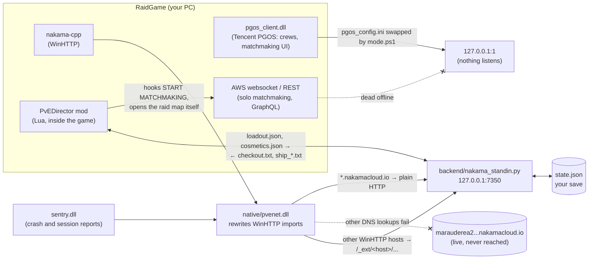
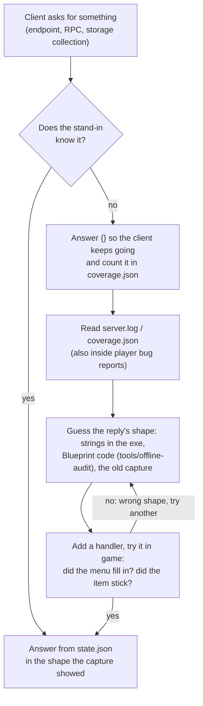

# backend/: the stand-in for servers that no longer exist

The game was built to talk to live servers that are gone. To play offline something has to answer it in their place.
`nakama_standin.py` is that something: a small local HTTP server that pretends to be the game's Nakama backend
(account, stash, loadouts, stats). Everything else the game used to reach is either redirected to nowhere on purpose,
or its job is done by the mod inside the game.

## Who answers what

- **Nakama** (account, storage, RPCs): `native/pvenet.dll` catches the game's WinHTTP calls and points
  `*.nakamacloud.io` at this stand-in, without TLS. Any other WinHTTP host (so far only Sentry's crash and session
  reports) comes here too, as `/_ext/<host>/<path>`: answered with `{}` and counted in `coverage.json` under "other
  services". Raw-socket lookups of anything that isn't local fail: GameAnalytics from the exe, and Nakama's realtime
  socket from nakama-cpp (nothing needs them yet). With a `capture/` folder, `capture/pvenet.log` lists each one.
- **PGOS** (Tencent's crew and matchmaking service): `scripts/mode.ps1 offline` swaps its config to `127.0.0.1:1`.
  Nothing answers there; the mod does the crew and matchmaking parts itself (`launch.lua`, `crewlobby.lua`).
- **The raid server's stash work** (what you take in, what you bring out) goes through files in this folder, written
  by the stand-in and read by the mod, and the other way round.

## Why it's built this way: we only ever see one side of the conversation

The servers are gone, so there's no documentation and no server code. What we have is the client: endpoint names
in the binary, one capture of real traffic from when the servers were up, and how the game behaves when it gets an
answer it doesn't like (usually: it waits forever, or silently does nothing). A player on Discord put it well: it's
like feeding a child who knows exactly which milk they want, but can't tell you the brand, flavour, glass, size or how
often. You keep offering combinations until they take the glass.

So the stand-in is built to make that guessing cheap:

- Unknown endpoints answer `{}` instead of an error, so one missing reply doesn't break everything after it.
- `coverage.json` counts what nothing answers, across sessions, so we see which missing features players actually
  reach (issue #80). The launcher's "Report a problem" zip includes it.
- `server.log` has every request, in order.

## Files

| File | What it is |
|---|---|
| `nakama_standin.py` | The server. The REST endpoints and RPCs it answers are listed in its docstring and `handle_any` |
| `seed.json` | The anonymous starting account every new save begins from (shipped) |
| `state.json`, `saves/` | Your saves (not shared: `.gitignore`) |
| `loadout.json`, `cosmetics.json`, `checkout.txt`, `ship_*.txt`, `gifts_in.txt` | Hand-offs between the stand-in and the mod (generated) |
| `server.log`, `last_game.log`, `coverage.json` | Logs (generated) |

## Adding or fixing a reply

1. Find the request in `server.log` (or a player's `coverage.json`): path, verb, body.
2. Add it to `handle_any` (REST) or `rpc()` (RPCs) in `nakama_standin.py`, keeping state in `state.json` through
   `save_state`.
3. Test without the game: `python tools/test_standin_gaps.py`. Then in game with a throwaway save: close the game first (the launcher stops the
   stand-in when the game closes) so PLAY starts it again with your change.

More detail: [docs/notes/backend.md](../docs/notes/backend.md), sections "Online backend" and "Backend capture".
