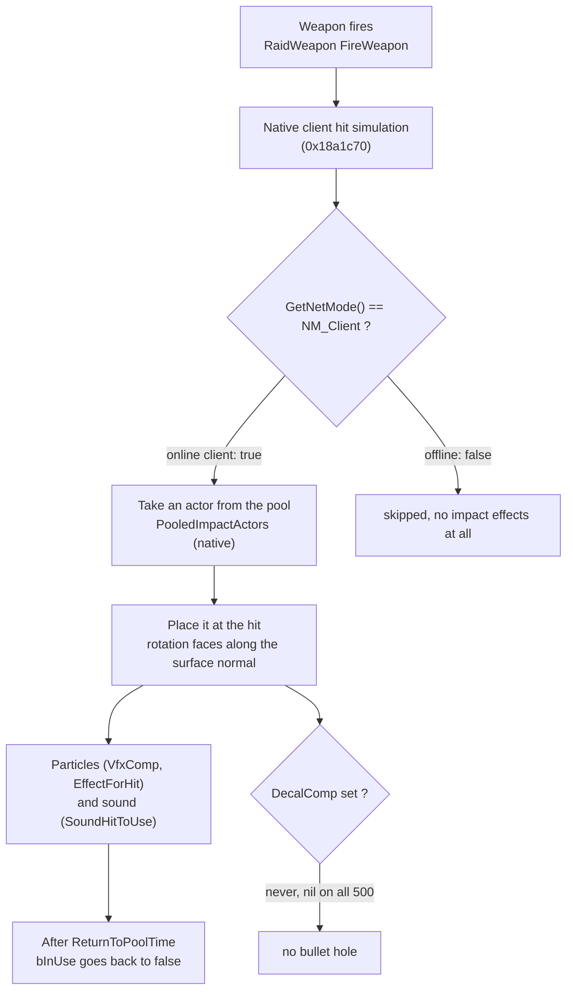
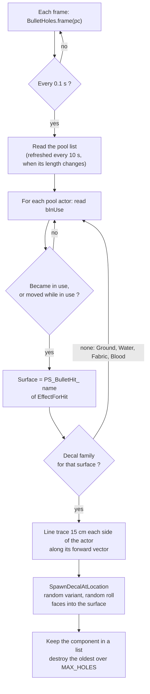
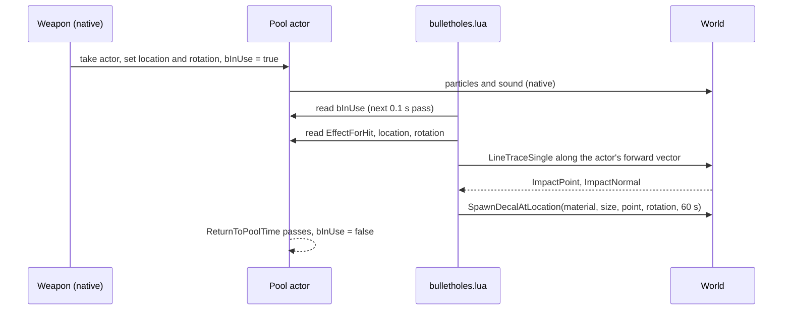
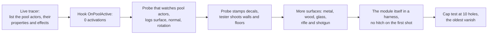

# Bullet impact reference

How a shot becomes an impact effect in the game, why the offline game left no bullet holes, and how the mod puts them
back. Written 2026-11-18 on the branch `fix/bullet-impacts-and-particles`. The mod code is
`mods/PvEDirector/Scripts/bulletholes.lua`, called every frame from `main.lua`. The reasoning and the dead ends are in the
section "Bullet holes (2026-11-18)" of [docs/notes/combat.md](../notes/combat.md); this file is the lookup for the chain and the record of the testing, so the
next person does not have to probe the same system again.

Every statement says where it came from:

| Source | Meaning |
| --- | --- |
| Measured | Read or watched live in game on a test install (Spaceport_01, the profiler probe runner, the live tracer). |
| Bytecode | Read from a Blueprint's compiled script or from native disassembly with `tools/offline-audit/kdis.py`. |
| Hooked | Seen by hooking a function and logging when it fired. |
| Tested | Done in game by the mod and confirmed by eye by the tester. |
| Guess | Inferred, not shown. Marked so nobody builds on it by accident. |

## What this found that was not known before

1. Impact effects for every shooter come from one pool of actors on the player controller,
   `RaidPlayerController.PooledImpactActors`: 500 actors of the class `BasePoolHitEffect_C` (a Blueprint on top of the native
   `RaidPoolImpactEffect`). Your shots and the bots' shots both take actors from it. (Measured)
2. The Blueprint has nothing in it. Its ubergraph is empty and the logic that takes an actor, places it, plays its particles and
   sound and gives it back is native. (Bytecode)
3. None of the 500 actors has a decal component. `DecalComp` is nil on every one, so the pool can never draw a bullet hole by
   itself. The actors do have a `DecalUSed` flag; what it is for is not known. (Measured, Guess for the flag)
4. A Lua hook on `RaidPoolImpactEffect:OnPoolActive` never fires, because native code calls it directly. A probe that hooked it
   saw 0 activations in a raid full of shooting. So the pool cannot be watched by hooking. (Hooked)
5. The pool can be watched by reading properties. Each actor has a `bInUse` flag the native code sets when it takes the actor
   for a shot, and clears when it gives it back (`ReturnToPoolTime` later). Reading it on 500 actors is cheap. (Measured)
6. An impact actor's own rotation points along the surface normal: a wall at the east side of the map has Yaw 180 (it faces
   minus X), a floor or a metal grating has Pitch 90 (it faces up), a ceiling has Pitch minus 90. A short line trace through
   the impact point along that direction then gives the exact surface point and the true normal. (Measured)
7. `EffectForHit` is the particle system the actor is using, and its name says what was hit: `PS_BulletHit_Concrete`,
   `MetalSolid`, `Wood`, `Glass` were all seen in play; `Tinplate`, `Ground`, `Water` exist as assets. Blood on a bot uses a
   blood cloud and the game already draws its own mark for it. (Measured)
8. The game ships its bullet hole decal materials and has them loaded in a raid: 38 of them, named
   `BulletImpactDecal_<family><n>_MIC`. Concrete 5, MetalSolid 5, MetalThin 5, Wood 5, Snow 5, Glass_BulletProof 3, Sandbag 4,
   Wall 3, Brick 1, Water 1, Blood 1. (Measured)
9. `GameplayStatics:SpawnDecalAtLocation(world, material, size, location, rotation, lifespan)` works from Lua. The size is half
   extents. The decal projects along its own X axis, so it is rotated to face into the surface. (Tested)
10. Metal had marks in some places before the mod: the tester saw them on a metal wall, and a bot's blood left its decal. A
    metal grating floor had none. The mod now adds holes on every metal impact; no doubled marks were reported. (Tested)

## The chain, and where it breaks offline

The gate at the top is the one the native patch "Bullet impact effects" in `pvepatch` removes (see [combat.md](../notes/combat.md),
"Bullet impacts (fixed, pvepatch)"): with it removed, particles and sound work offline, and the pool is filled the way it is online. What was left
is the decal, which the pool actor does not have at all. (Bytecode, Measured)

## What the mod does

The same thing as a sequence, for one shot:

### Surface to decal

| Pool effect (`PS_BulletHit_...`) | Decal family used | Seen in play |
| --- | --- | --- |
| Concrete | Concrete (5 variants) | Yes, walls, floors, ceilings (Measured, Tested) |
| MetalSolid | MetalSolid (5) | Yes, walls and floor grating (Measured, Tested) |
| Wood | Wood (5) | Yes (Measured) |
| Glass | Glass_BulletProof (3) | Yes, stamped without errors (Measured) |
| Tinplate | MetalThin (5) | Not seen in the pool yet (Guess that the name matches) |
| Snow | Snow (5) | Not seen, no snow map tried (Guess) |
| Ground, Water, Fabric | none | Left alone: the game ships no hole material for dirt or fabric, and a water mark on water would be wrong |
| Blood (a bot) | none | The game draws its own mark |

Sandbag, Wall and Brick materials exist but no pool effect is named for them, so nothing selects them yet.

### Settings

F3, tab "Effects". Saved with the rest of the tuning. The F9 debug menu also has a "Bullet holes: ON / off" button that flips
`BULLET_HOLES`, so the effect can be switched off in play without opening the tuning menu (holes already placed fade on their own).

| Setting | Default | What it does |
| --- | --- | --- |
| `BULLET_HOLES` | 1 | 1 on, 0 off. |
| `HOLE_SECONDS` | 60 | A hole fades out after this long (the engine removes the decal at its lifespan). |
| `MAX_HOLES` | 250 | Most holes alive; the oldest are destroyed first. A shotgun in a firefight makes dozens at once. |
| `HOLE_SIZE` | 5 | Half the width in cm: 5 is a 10 cm hole. |

## Cost

| Step | Time | Source |
| --- | --- | --- |
| Read the whole pool list (`ForEach` over 500 actors) | about 2 ms, only when the list is refreshed | Measured |
| `FindAllOf("BasePoolHitEffect_C")` | about 17 ms, so the mod does not use it | Measured |
| `K2_GetActorLocation` on 500 actors | about 4 ms, so the mod only asks for actors that are in use | Measured |
| Property read on 500 actors (`RootComponent`; `bInUse` is the same kind of read and was not timed alone) | about 1 ms | Measured |
| Material scan (once per raid, on the first quiet pass) | 26 to 28 ms, one frame | Measured |
| One hole (trace plus spawn) | not timed alone; apart from the material load, no frame over 20 ms was logged in the test sessions | Measured |

## Things that went wrong on the way

| What | Why | What was done |
| --- | --- | --- |
| First probe hooked `OnPoolActive` and stamped nothing | Native calls it, so a Lua hook never fires (0 activations) | Watch `bInUse` instead |
| First stamping version used the camera to find the surface and rejected every impact (the trace landed 260 to 2600 cm off) | Bots' impacts are not on your view line, and a camera ray can be blocked by anything in between | Trace along the impact actor's own forward vector, which is the surface normal |
| First test decals looked huge | `SpawnDecalAtLocation` takes half extents | `{ X = 12, Y = 5, Z = 5 }`: a 10 cm hole |
| Metal got no hole at first | The first version assumed the game marked metal itself, which it only does in some places | Metal is stamped too |

None of the testing hooked an engine static function (spawn, play, damage). Those froze or crashed the game twice during the
explosion work ([space.md](../notes/space.md), "Space object explosions and sounds"), and this mod calls them and does not hook them.

## How it was tested

- Probe stamping, concrete: 18 holes, flat on the wall, size right, rifle and shotgun both. (Tested)
- Probe stamping, a longer run: concrete 221, metal 70, wood 30, glass 31, no errors. (Measured)
- The module, harness run: all four surfaces stamped, no errors, one 26 to 28 ms frame when the materials load, none after.
  (Measured)
- Cap of 10: about 10 holes stayed on the wall, a new group appeared for every shotgun blast. (Tested)

## Not known yet

- Tinplate, snow and ground impacts: no map tried. If a surface is not in the table above, the log line
  `bullet holes: first <name> impact: none` appears once with its name, so a tester can report it.
- Whether the game's own marks (a metal wall, blood) double up with the mod's on any surface. No doubles were reported.
- What `DecalUSed` on the pool actor does.
- Hits on a moving surface (a ship hull, a door that opens): the hole is placed in the world and does not follow the surface.
- Shotgun gunshot sound: some blasts are silent from one standing spot. That is the weapon's own sound, not the impact, and
  has not been looked at.
