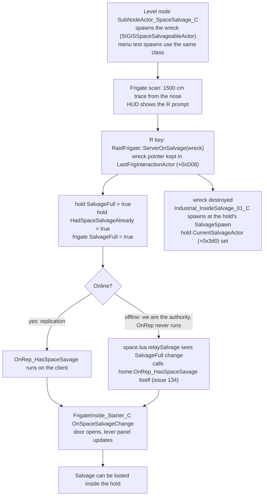
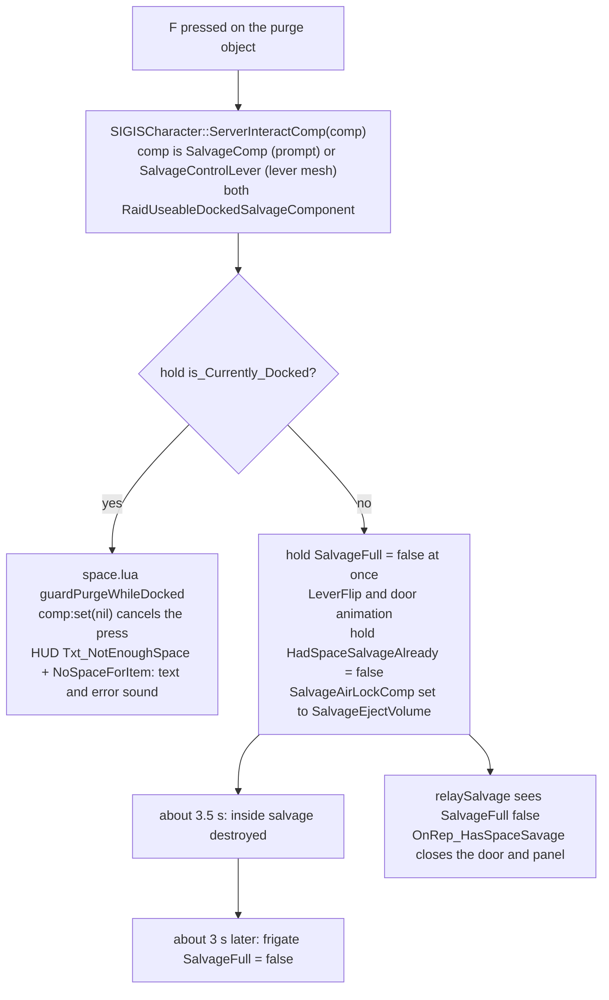
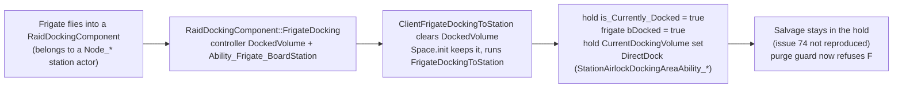

# Salvage chain reference

How salvage works in the game from a wreck in space to loot in your hold and back out through the airlock, how it
behaves offline, and everything that was read from the running game to find that out. Written 2026-11-18 while fixing
issue 134 (salvage stuck behind a shut door) and the purge while docked bug. The mod code is `relaySalvage` and
`guardPurgeWhileDocked` in `mods/PvEDirector/Scripts/space.lua`. The reasoning and dead ends are in the sections
"Salvage in the hold stayed behind a shut door" and "Purging salvage while docked is refused" of
[docs/notes/space.md](../notes/space.md);
this file is the lookup for the chain itself.

Every statement says where it came from:

| Source | Meaning |
| --- | --- |
| Measured | Read or watched live in game with the salvage logger on a test install (Space_Solo_01, starter frigate). |
| Bytecode | Read from the Blueprint's compiled script with `tools/offline-audit/kdis.py`. |
| Hooked | Seen by hooking a function and logging when it fired. |
| Guess | Inferred, not shown. Marked so nobody builds on it by accident. |

Words used below: the **hold** is the ship's interior actor (`RaidSpaceshipInside`, for the starter frigate the Blueprint
`FrigateInside_Starter_C`). The **frigate** is the flying ship (`RaidFrigate`, `Ship_StarterFrigate01_Pawn_C`). A **wreck**
is salvage floating in space. **Inside salvage** is the crate that appears in the hold.

## The short version

- All of the rules are native code. The Blueprints around it only do UI, doors and animation (Bytecode).
- One thing never runs offline: `OnRep_HasSpaceSavage`, which the Blueprint needs to open the hold door and update the
  panel. A replication callback only runs on a client, and offline you are the server. The mod calls it by hand.
- Purging is a lever press that reaches the server as `SIGISCharacter::ServerInteractComp`. Docked purging was never
  allowed in the original game. Offline nothing refuses it, so the mod cancels that one press while docked.

## The cast

| Thing | Class or name | Notes | Source |
| --- | --- | --- | --- |
| Wreck in the level | `SIGISSpaceSalvageableActor` | Placed by `SubNodeActor_SpaceSalvage_C` nodes. Level wrecks sit at identical coordinates every run. Menu spawns use the same wreck class (`Industrial_`, `Ammo_`, `Medic_`, `Rare_SpaceSalvage_01`, folder `/Game/Blueprints/NodeSystem/Lootables/`). | Measured |
| Inside salvage | `Industrial_InsideSalvage_01_C` (`SIGISSpaceSalvageableInsideActor`) | Spawns at the hold's `SalvageSpawn`, a child of `SalvageComp` tagged "Salvage". | Measured |
| Frigate | `RaidFrigate` | `SalvageFull` (+0xC38), `LastFrigInteractionActor` (+0xD08, the wreck being taken), `bDocked`. | Measured |
| Hold | `RaidSpaceshipInside` / `FrigateInside_Starter_C` | `SalvageFull` (+0x3C8), `HadSpaceSalvageAlready`, `CurrentSalvageActor` (+0x3D0), `is_Currently_Docked`, `CurrentDockingVolume`, `SalvageControlLever`, `SalvageComp`, `SalvageAirLockComp`, `SalvageSpawn`, `SalvageEjectVolume`. | Measured |
| Purge prompt | `SalvageComp`, class `RaidUseableDockedSalvageComponent` | A static mesh component derived from `RaidUseableComponent`. Functions `Interact`, `CanUseComp`, `OnBPCompUsed`, `SetState`, `GetInteractionInfo`. Properties `DisplayName`, `CurrentState`, `TimeForSlavageremoval` (3.0). | Measured |
| Purge lever | `SalvageControlLever`, same class as `SalvageComp` | The lever mesh. F on either one is a purge press. | Measured |
| Docking | `RaidDockingComponent` on `Node_*` station actors | Docking areas are `StationAirlockDockingAreaAbility_*`. | Measured |

## Pickup: R on a wreck

Notes (Measured unless said):
- The scan that finds a wreck is a 1500 cm trace from the frigate's nose, so a wreck has to be roughly in front of the ship.
  The test menu spawns one 10 m ahead for that reason.
- After R the hold, frigate and wreck all change within the same frame. The wreck is destroyed and the inside salvage
  appears at once. Nothing is carried over by a timer.
- Without the relay the state is wrong in a recognisable way: the door stays shut, the panel reads "LOCKED / NO SALVAGE
  DETECTED", yet the lever offers "F PURGE SALVAGE". Calling `OnRep_HasSpaceSavage` on the hold fixes all three.

## Purge: F on the lever or the prompt

Timeline of an undocked purge (Measured, from the logger):

| Time after F | What changes |
| --- | --- |
| 0 s | hold `SalvageFull` false, `LeverFlip` and the door animation start, `HadSpaceSalvageAlready` false, `SalvageAirLockComp` set to `SalvageEjectVolume`. |
| about 3.5 s | The inside salvage actor is destroyed. |
| about 6.5 s | The frigate's `SalvageFull` goes false. |

`TimeForSlavageremoval` on the prompt is 3.0 (the spelling is the game's).

## How an F press reaches the server

The interaction system is `/Script/SIGISPlugin.SIGISCharacter`. Functions: `StartInteraction`, `StopInteraction`,
`ProcessInteraction`, `ServerInteract`, `ServerInteractComp`. Properties: `LastInteractionActor`, `LastInteractionComp`,
`IsInteracting`.

- F on the purge object calls `ServerInteractComp` with the component's name as `SalvageComp` or `SalvageControlLever`
  (Hooked). Hooks on `StartInteraction`, `ProcessInteraction` and `StopInteraction` did not see the press as the thing to
  block; the first attempt hooked `StartInteraction` and never fired.
- A `RegisterHook` pre callback `function(self, comp) comp:set(nil) end` on `ServerInteractComp` cancels the press, which
  the player sees as a button that does nothing. The prompt stays on screen, as in the original game.
- `ServerInteract` (no component) fired once during testing. It was not the purge path and is not guarded.
- Offline, `main.lua` drives interaction detection itself (`CFG.INTERACT_SECONDS`) and `missions.lua` overrides
  `pawn.LastInteractionActor`, so check those before assuming vanilla behaviour for any other interaction.

## Docking

- Docked state is readable in three places: the hold's `is_Currently_Docked`, the frigate's `bDocked` and the hold's
  `CurrentDockingVolume`. The guard uses the hold's flag.
- `Base_Frigate_Ship_C::CheckifAbleToDock` (which calls `IsValid(DockingCheck())`) is what drives the HUD's
  `SetAbleToDockPrompt` (Bytecode).
- Salvage survived docking for menu spawned and level wrecks (Measured). Issue 74 ("salvage gone on docking") could not be
  reproduced either way. Its build and map are unknown; ask the reporter.
- Guess, not tested: the original game probably refuses a docked purge by reading the airlock's cycle state. We never
  confirmed where that check lives, so the mod refuses at the press instead.

## Blueprint findings (UI only)

Dumped with `kdis.py` from the live game (Bytecode):

- `FrigateInside_Starter_C::OnSpaceSalvageChange` is a stub that jumps into `ExecuteUbergraph_FrigateInside_Starter`. The
  door and panel work is in the ubergraph. Only `OnRep_HasSpaceSavage` calls it.
- Other salvage related Blueprint functions: `FrigateInside_Starter_C` `AirLockOpenCloseState`, `LeverFlip` (update and
  finished), `NotReadyToDock`, `ReadyToDock`, `SetStateOnInAirlockWidget`, `TimerForCheckingifHaveSalvage`;
  `Base_SalvageInShipActor_C` `ActiveCalled`, `DeActiveCalled`, `ReceiveBeginPlay` and a timeline;
  `Base_Frigate_Ship_C` `SalvageEvent`, `CheckIfCanDock`, `CheckifAbleToDock`.
- None of them hold a rule about who may purge or when. The rules are native.

## Showing a refusal on screen the way the game does

A full inventory gives the player "NOT ENOUGH SPACE" with an animation and an error sound. The route (Measured):
`SIGISInventoryComponent::Client_NoSpaceInInventory` then `SIGISHUD::BP_NoSpaceForItem` then `MatchHUD_C` and
`HUD_Main_Widget_C::NoSpaceForItem`. The widget has `Txt_NotEnoughSpace`, `Border_NotEnoughSpaceWarning` and
`Anim_NotEnoughSpace`. Setting `Txt_NotEnoughSpace` and calling `NoSpaceForItem()` on the overlay instance
named "In Game Overlay Match" gives that exact look and sound with different text. Put the original text back afterwards.
The text box is sized for the stock wording, so a longer message renders a little smaller.

What did not work as a player facing message (Measured):
- `PlayerController:ClientMessage` (used by other mod messages) did not show here.
- `HUD_Message_SubWidget_C` (`DisplayMessage`, `Txt_Message`, `Anim_Show`, `Anim_Hide`) does show, small in the top right,
  with no sound.

Error sounds found loaded in the game (Cue paths under `/Game/Sounds/UI/` unless noted): `UI_Airlock_Error01_Cue`,
`UI_InMatch_Error01_Cue`, `UI_Error_Cue`, `UI_Error_NotEnough_Cue`, `UI_Error_CantScrapThis_Cue`, `UI_Keypad_Error01_Cue`,
`UI_Chat_Error_Cue`, and under `/Game/Sounds/UniqueActors/`: `JukeBox/SC_JukeBox_CantDoThat`,
`VendingMachine/SC_VendMachine_CantUse`. Play one with `GameplayStatics:PlaySound2D` if a message needs a sound of its own.

## Engine behaviour that cost time

- **Destroyed actors linger.** A destroyed actor still passes `IsValid` and appears in `FindAllOf` until garbage
  collection, about every 60 s. Its `K2_GetActorLocation` reads 0 0 0. Do not treat "still valid" as "still exists" when
  watching a wreck.
- **Teleports can fail silently.** `K2_TeleportTo` returns false, and `pcall` reports success, when the destination
  overlaps geometry. Use `K2_SetActorLocationAndRotation(loc, rot, false, {}, true)` and check the position afterwards.
- **Null object wrappers can crash the game.** Calling a method on a wrapper for a null object, even inside `pcall`, hit
  a native access violation. Check `o ~= nil and o:IsValid()` first.
- **No replication callbacks offline.** Any `OnRep_*` that a Blueprint relies on has to be called by the mod. This is the
  same bug class as issue 134, and the other `OnRep_*` on the hold and frigate are worth checking when something "works
  online only".
- **`ClientMessage` text is not a reliable on screen message** (see above).

## How this was found (to repeat it)

1. Turn on profiler mode (`_G.PVE_PROF`). `main.lua` then runs `bridge/dir_eval.lua` once in the game's Lua state and writes
   its return value to `bridge/dir_eval.out` (and deletes the script). That is the quickest way to read properties,
   list loaded objects (`FindAllOf`, including `Function` and `SoundCue`) and register hooks on a running game. Hooks
   stay for the session, so guard registration with a `_G` flag.
2. Log the hold, frigate and wreck properties around R, F and a docking: `SalvageFull`, `HadSpaceSalvageAlready`,
   `CurrentSalvageActor`, `bDocked`, `is_Currently_Docked`, `CurrentDockingVolume`. Log object pointers only from the
   frigate and hold; reading them from every component is noisy.
3. Hook `ServerOnSalvage` and `ServerInteractComp`, and list the functions of the Blueprint classes involved.
4. Read the Blueprint bytecode with `tools/offline-audit/kdis.py` for any function that might hold a rule. For this
   chain none did.
5. The throwaway logger and the test menu buttons used here (spawn a wreck, fly the ship to a wreck, fly the ship to the
   nearest dock) live in the test install only and are not part of the repo.

## Still unknown

- Where the original game checks "docked" for the purge (see the guess above).
- What issue 74 was (build, map, how the salvage went missing).
- Whether `ServerInteract` with no component can purge in any situation. It was seen once and not tied to the lever.
