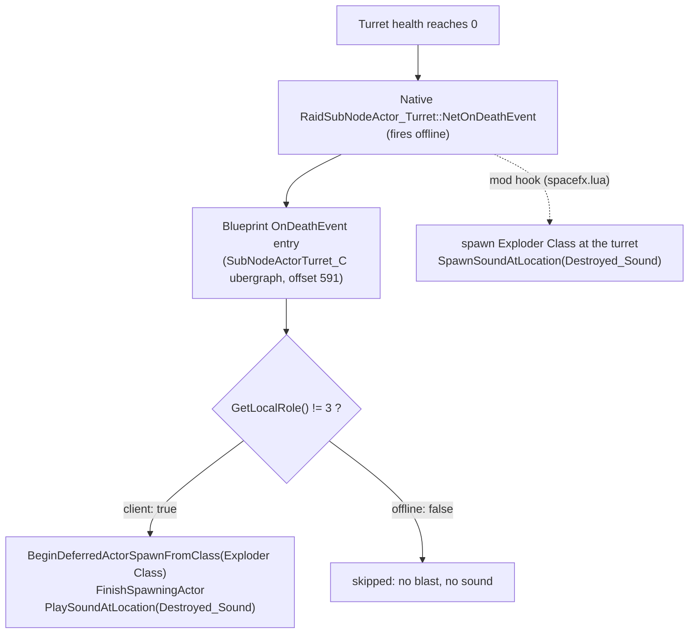
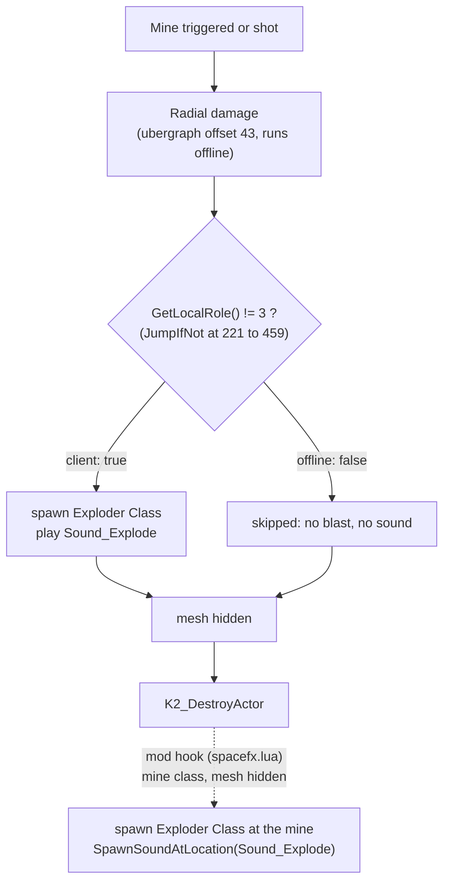
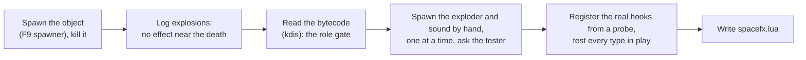

# Space object death reference

What happens in the game when a space turret is destroyed or a space mine goes off, why nothing showed or sounded offline, how the
mod puts it back, and how every part of that was found out. Written 2026-11-18 while fixing issue 15 (no explosion effects or sounds
for mines, turrets and radar dishes). The mod code is `mods/PvEDirector/Scripts/spacefx.lua`, loaded from `Space.init` in
`space.lua`. The reasoning is in the section "Space object explosions and sounds (2026-11-18, issue #15)" of
[docs/notes/space.md](../notes/space.md); the tools used to
test it are in [tools/space_test](../../tools/space_test/README.md). This file is the lookup for the chain itself and the record of
the testing, so the next person does not have to probe the same system again.

Every statement says where it came from:

| Source | Meaning |
| --- | --- |
| Measured | Read or watched live in game on a test install (a space map, the profiler probe runner, the F9 test tools). |
| Bytecode | Read from the Blueprint's compiled script with `tools/offline-audit/kdis.py`. |
| Hooked | Seen by hooking a function and logging when it fired. |
| Tested | Done by hand or by the mod in game and confirmed by eye and ear by the tester. |
| Guess | Inferred, not shown. Marked so nobody builds on it by accident. |

## What this found that was not known before

1. Turrets and mines build their blast and play their sound only on the client half of a role check, `GetLocalRole() != 3`.
   Offline the role is 3, so the effect is skipped, and everything else about the death (damage, health, removal) still runs.
   (Bytecode)
2. The role check is `NotEqual_ByteByte(GetLocalRole(), 3)`. That is a different shape from the `HasAuthority` and `IsServer`
   branches that `bpbranch.py` lists and that `pve_bp_jump` can open, so the scan never showed it and the native patch cannot
   reach it. A search of dumped bytecode for `GetLocalRole` finds more of these. (Bytecode)
3. The native turret function `RaidSubNodeActor_Turret::NetOnDeathEvent` fires offline when a turret dies. The functions you would
   expect to hook, `OnDeathEvent`, `HealthChanged` and `OnRep_Health`, did not log offline. So the native one is the hook point.
   (Hooked)
4. Every exploder Blueprint (`/Game/Blueprints/Exploders/`) has particles and a destructible and no audio. The sound of a death is
   always a property of the dying object (`Destroyed_Sound` on turrets, `Sound_Explode` on mines), never of the exploder. (Measured)
5. Each object carries its own `Exploder Class` and sound, so one hook serves every turret and mine kind. No table of kinds is needed.
   (Measured)
6. A mine's radial damage runs before the role check, which is why mines still hurt offline while showing nothing. (Bytecode)
7. Sound from a Lua probe: `GameplayStatics:SpawnSoundAtLocation` is heard every time; `PlaySoundAtLocation` and `PlaySound2D`
   called the same way seemed silent. (Tested)
8. The first attempt at a mine hook, on `ApplyRadialDamageWithFalloff`, was followed by a game crash when the nuclear mine went
   off. Spawning the nuclear blast and sound by hand does not crash, and neither does the `K2_DestroyActor` hook. (Tested)
9. The F9 space spawner can only offer turret and mine kinds that are alive in the current level, because it builds its list from
   live actors. (Measured)
10. A hook registered from a probe lives until the game restarts. To test mod code that registers the same hook you must relaunch,
    or the old probe hook runs beside it. (Measured)

## The short version

- Both objects build their blast and play its sound behind `if GetLocalRole() != 3` (3 is ROLE_Authority). That is the client half.
  Offline you are the authority, so the test is false and the blast and the sound are skipped.
- Nothing else is missing. Damage, health, the mine's radial damage, hiding the mesh and destroying the actor all run. Only the
  visible and audible part is lost.
- The fix reads the exploder and the sound off the dying actor and does the skipped part by hand, at the actor's place, once.

## The cast

| Thing | Class or name | Notes | Source |
| --- | --- | --- | --- |
| Turret base (native) | `RaidSubNodeActor_Turret` | `NetOnDeathEvent` fires offline when a turret dies. `OnDeathEvent`, `HealthChanged` and `OnRep_Health` hooked natively did not log offline. | Hooked |
| Turret Blueprint | `SubNodeActorTurret_C` | Properties `Exploder Class`, `Destroyed_Sound`. Its event graph is `ExecuteUbergraph_SubNodeActorTurret`, with the OnDeathEvent entry at bytecode offset 591. | Measured, Bytecode |
| Radar dish | `Radar_NodeTurret_C` | Has its own `OnDeathEvent` and ubergraph (decompiled too). Covered by the same native hook. | Bytecode, Tested |
| Mine Blueprint | `SubNodeActorMine_C`, instances `Small_NodeMine_C`, `Nuclear_NodeMine_C` | Properties `Exploder Class`, `Sound_Explode`, `Sound_Triggered`, `Active?`, and a `StaticMesh`. Functions `TriggeredEffects`, `OnTakeAnyDamage_Event`, `ReceiveRadialDamage`, `ExecuteUbergraph_SubNodeActorMine`. | Measured, Bytecode |
| Exploders | `/Game/Blueprints/Exploders/`: `Radar_Exploder_Child`, `FlakTurret_Exploder_Child`, `RocketTurret_Exploder_Child`, `TripleTurret_Exploder_Child`, `Mine_Exploder_Child`, `NuclearMine_Exploder_Child`, base `Exploder_Base` | Particles and a destructible. No audio in any of them. | Measured |
| Sounds | Small mine `Space_Mines_Explosion01_Cue`, nuclear mine `Space_Mines_ExplosionNuke02_Cue` | Turret `Destroyed_Sound` differs per turret: flak is a metal groan, a radar dish a low rumble. Turret sound attenuation: inner radius 4000 cm, falloff 40000 cm. | Measured, Tested |
| Which exploder goes with what | Small mine: `Mine_Exploder_Child_C`. Nuclear mine: `NuclearMine_Exploder_Child_C`. | Read off the live mine's `Exploder Class` | Measured |

## The chains





Offsets are bytecode positions in the Blueprint's ubergraph (Bytecode).

How the fix was found, as a flow:



## What the mod does

| Object | Hook | Reads from the actor | Source |
| --- | --- | --- | --- |
| Any turret | `/Script/RaidGame.RaidSubNodeActor_Turret:NetOnDeathEvent` | `Exploder Class`, `Destroyed_Sound`, its location and rotation | Tested: every turret type, naval base turrets included |
| Any mine | `/Script/Engine.Actor:K2_DestroyActor`, only for a class named `*NodeMine*` whose `StaticMesh` is no longer visible | `Exploder Class`, `Sound_Explode`, its location and rotation | See "Unknowns" |

The blast is `World:SpawnActor(Exploder Class, location, rotation)`. The sound is
`GameplayStatics:SpawnSoundAtLocation(actor, cue, location, rotation, 1, 1, 0, nil, nil, true)`, the same call `voice.lua` uses. A
mesh that is still visible when the mine is destroyed means it was cleaned up with the level, not triggered, so no effect. Each
actor is handled once (its address is remembered for 10 s, since addresses get reused).

Designs that were rejected, and why:

| Idea | Why not |
| --- | --- |
| `pve_bp_jump` the role gate open | It only patches a `JumpIfNot` after `CallMath(self)` or a no argument `FinalFunction`. This gate is `NotEqual_ByteByte(GetLocalRole, 3)`: a new DLL export would be needed, and the mod would then depend on the native patch for something Lua can do. |
| Call the dying turret's own death functions | They run the same Blueprint code with the same gate (the F9 "Try explosion fix" experiment). |
| Hook `ApplyRadialDamageWithFalloff` for mines | A first version did this and the game crashed when the nuclear mine went off. Not proven to be the cause, but the `K2_DestroyActor` hook has not crashed. |
| A table of exploder and sound per kind | Each actor already carries both. A table would go stale with every new kind. |
| Hook `OnDeathEvent` or `OnRep_Health` | Did not fire offline (Hooked). |

## The testing, in the order it happened

| Step | What was done | Result |
| --- | --- | --- |
| 1 | Spawned turrets and mines with the F9 spawner, pressed Kill, Log explosions on | Nothing near any of them: "no effects on any of the turrets" |
| 2 | Hooked the native turret functions and logged (`turret_events.txt`) | `NetOnDeathEvent` fires; `OnDeathEvent`, `HealthChanged`, `OnRep_Health` do not |
| 3 | `kdis` on the turret, radar and mine functions (addresses from a probe, same game session) | The role gate, offsets 591 (turret), 43 and 221 to 459 (mine) |
| 4 | Radar dish: its `Exploder Class` spawned by hand, then its sound | Explosion seen. The sound was a low rumble the tester could not place, with rival ships shooting nearby |
| 5 | Moved the nearby AI frigates 6000 m up (`K2_SetActorLocation`), repeated the sounds | Quiet enough to hear; `PlaySoundAtLocation` and `PlaySound2D` silent, `SpawnSoundAtLocation` heard |
| 6 | Flak turret: blast, then sound | Explosion and a metal groan |
| 7 | Rocket turret | Could not be tested by hand: no live instance, and its class was not found by `GetCDO`, a `Default__` lookup or a path lookup |
| 8 | First mine hooks (`ApplyRadialDamageWithFalloff`) with the nuclear mine | The game crashed |
| 9 | Relaunched. Small mine by hand (`Mine_Exploder_Child_C`, `Space_Mines_Explosion01_Cue`), 30 m ahead, 10 s countdown | Explosion and sound |
| 10 | Nuclear mine by hand (`NuclearMine_Exploder_Child_C`, `Space_Mines_ExplosionNuke02_Cue`), 60 m ahead, 12 s countdown, step notes written first | Explosion and sound, no crash |
| 11 | The real hooks (turret `NetOnDeathEvent`, mine `K2_DestroyActor` with a hidden mesh check) registered from a probe, with step notes, then every turret killed in play | Every turret type works, naval base turrets included |
| 12 | Wrote `spacefx.lua` from the tested hooks | Syntax checked and the local variable headroom checked with `scripts/luacheck.py`; needs a relaunch to run in game |

Which parts have been shown, by object:

| Object | Blast by hand | Sound by hand | Real hook in play |
| --- | --- | --- | --- |
| Radar dish | Tested | A rumble was heard, not identified | Tested |
| Flak turret | Tested | Tested (groan) | Tested |
| Rocket turret | Not possible (no instance) | Not possible | Tested (the tester confirmed every turret type) |
| Triple turret | Not tried by hand | Not tried by hand | Tested (same) |
| Small mine | Tested | Tested | Not reported yet |
| Nuclear mine | Tested, no crash | Tested, no crash | Not reported yet |

## The probe

The probe runner is `bridge/profile_on` present plus `bridge/dir_eval.lua`: the director runs the script once in the game's Lua
state, writes what it returns to `bridge/dir_eval.out` and deletes the script (search [docs/notes/](../notes/) for `bridge/profile_on`). Each effect
was made by hand like this, with a countdown so the tester is looking, and a note written to a file before each step so a crash shows
where it stopped. This is the small mine version; the nuclear mine used the kind `Nuclear_NodeMine`, 60 m ahead and a 12 s delay.

```lua
local function ok(o) local a, v = pcall(function() return o ~= nil and o:IsValid() end) return a and v end
local base = require("pveproject") .. "bridge/"
local KIND, SOUNDKEY = "Small_NodeMine", "Sound_Explode"
local function note(s) local fh = io.open(base .. "spacefx_steps.txt", "a") if fh then fh:write(("%.1f %s\n"):format(os.clock(), s)) fh:close() end end
local src
for _, x in ipairs(FindAllOf("RaidSubNodeActor") or {}) do
    if ok(x) and x:GetClass():GetFName():ToString():find(KIND, 1, true) then src = x break end
end
if not src then return "no " .. KIND .. " found" end
local cls, snd = src["Exploder Class"], src[SOUNDKEY]      -- each actor carries its own blast and sound
note("READY")
ExecuteWithDelay(10000, function()                           -- the tester is told to watch
    local me = FindFirstOf("PlayerController").Pawn
    local loc, fwd = me:K2_GetActorLocation(), me:GetActorForwardVector()
    local at = { X = loc.X + fwd.X * 3000, Y = loc.Y + fwd.Y * 3000, Z = loc.Z + fwd.Z * 3000 }
    local world = FindFirstOf("World")
    local gs = StaticFindObject("/Script/Engine.Default__GameplayStatics")
    note("FIRE explosion")
    pcall(function() world:SpawnActor(cls, at, { Pitch = 0, Yaw = 0, Roll = 0 }) end)
    note("FIRE sound")
    pcall(function() gs:SpawnSoundAtLocation(me, snd, at, { Pitch = 0, Yaw = 0, Roll = 0 }, 1.0, 1.0, 0.0, nil, nil, true) end)
    note("DONE")
end)
return "fires in 10 s, 30 m ahead"
```

To see the objects a map has: `FindAllOf("RaidSubNodeActor")` returns the turrets and mines (turret kinds contain `NodeTurret`, mine
kinds `NodeMine`). To keep AI ships from shooting during a sound test, move the live ones away with
`ship:K2_SetActorLocation({X = l.X, Y = l.Y, Z = l.Z + 600000}, false, {}, true)`; they come back over time.

## Things learned the hard way

- `pve_bp_jump` (native/pvepatch.c) patches a `JumpIfNot` only after `CallMath(self)` or a no argument `FinalFunction`. This gate is
  `NotEqual_ByteByte(GetLocalRole(), 3)`, a different shape.
- `bpbranch.py` finds branches on `HasAuthority`, `IsServer` and `IsStandalone`. It does not see `GetLocalRole` compares.
- Sound: `SpawnSoundAtLocation` with an actor as the context object. `PlaySoundAtLocation` and `PlaySound2D` seemed silent from probes.
  Rival ships shooting nearby masked what the tester heard, so move them first.
- A hook registered by a probe stays until the game restarts. Guard probe hooks with a `_G` flag, and relaunch before testing mod
  code that registers the same hook.
- A first mine hook on `ApplyRadialDamageWithFalloff` was followed by a game crash on the nuclear mine; the cause was not proven. Fire
  the nuclear mine last when testing, with a step note before each effect.
- The F9 spawner lists only the kinds alive in the level (it builds the list from live actors), so a level with no rocket turret
  offers none, and looking the class up by `GetCDO`, `Default__` or path did not work either.
- Radar dish sound is a low rumble, easy to take for something else when you expect an explosion.
- Addresses read from the live game (for kdis) die with the game session. Run kdis in the same session as the probe.
- Whole file line ending changes (CR only) showed up in git status on the Windows side, twice, with no content change; what
  rewrites the files was not found. `git diff --ignore-cr-at-eol` tells that noise from a real change, and `git checkout -- <file>`
  clears it.

## Unknowns

- The mine hook through real triggering (flying into a mine, shooting one) was registered in the same session as the turret test.
  The blast and sound for both mine sizes were confirmed by hand. Mark the hook Tested here once someone has watched a real mine go
  off with it.
- The rocket turret and the triple turret were not spawned by hand. The turret hook covers them and the tester confirmed every
  turret type in play.
- Whether other client side effects hang off the same gate (a turret's hit sparks, a mine's trigger sound `Sound_Triggered`) was not
  checked.
- Why the Blueprint functions `OnDeathEvent`, `HealthChanged` and `OnRep_Health` did not log when hooked natively offline: not
  investigated. The native `NetOnDeathEvent` is the one that fires.

## How to repeat it

1. Install the test tools into a test copy: `python tools\space_test\install.py <test install>\mods\PvEDirector\Scripts`.
2. Start a space raid (F9), switch Log explosions on, spawn a kind, Kill it. Read `bridge/explosions.txt` and
   `bridge/space_explosion.txt`.
3. `python tools\space_test\kdis_logged.py <install> explosions` in the same session reads the Blueprint bytecode of the logged
   functions. Search it for `GetLocalRole`.
4. Make the blast and sound by hand from a probe, one at a time, before writing a hook (the probe above).
5. After a game update, repeat step 2 and check that every kind still shows its effect with `spacefx.lua` in place.
