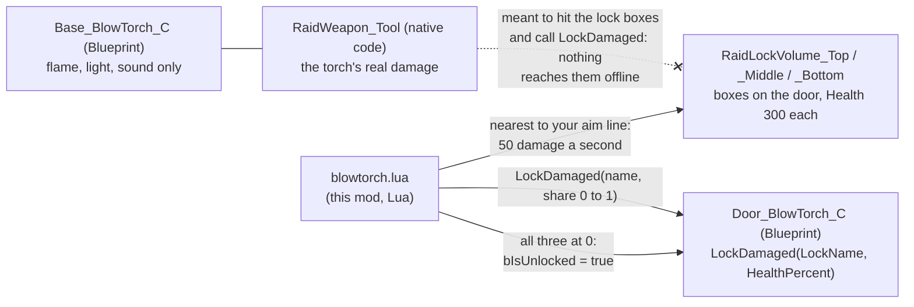
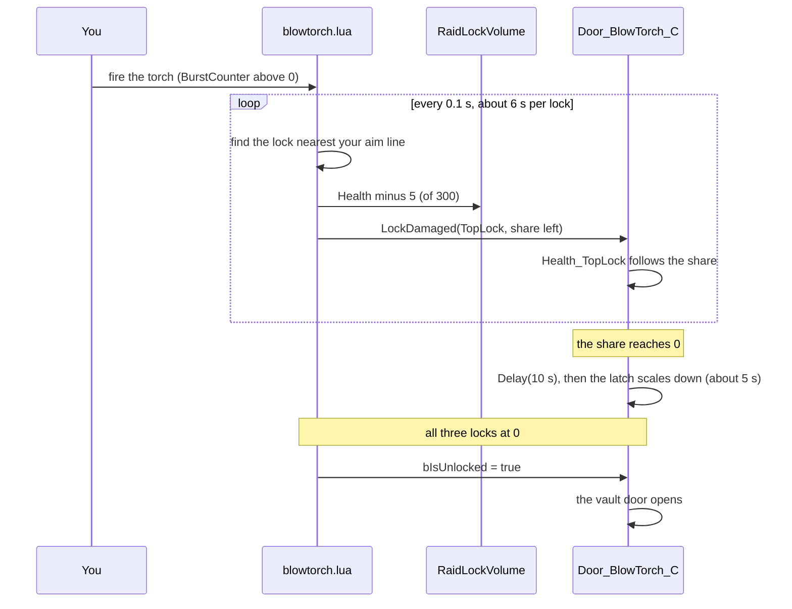
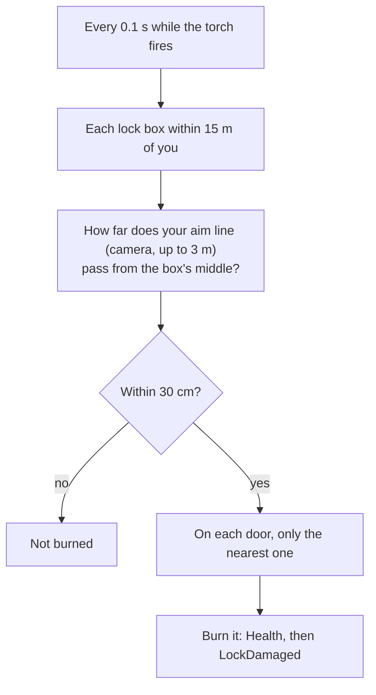
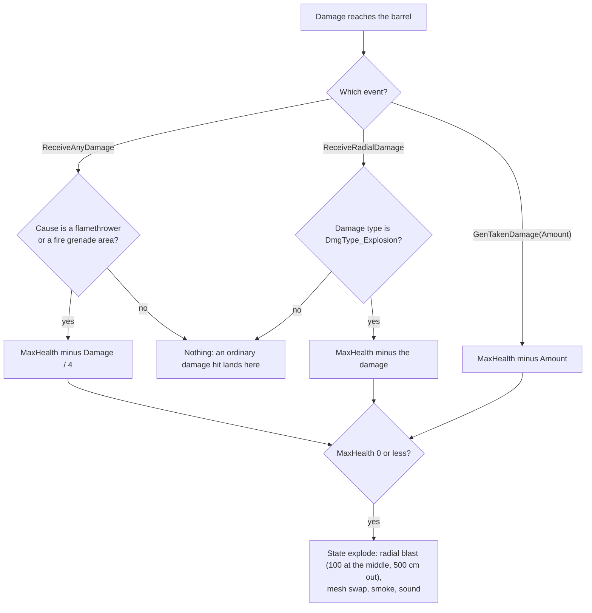

# The blowtorch offline: why it didn't open a vault, and what stands in for it

The vault door in a raid has three pieces of metal (a top, middle and bottom lock) that you burn through with the blowtorch.
Offline the torch lit up, made its noise and hurt soldiers, but the locks never changed and the door kept saying "F requires
blowtorch". `Scripts/blowtorch.lua` does the missing part. This page is how the pieces fit, so the next interaction like this
one (a tool, a door, a prop that reacts to a hit) can be worked out the same way.

## Who does what

- **The torch's Blueprint is cosmetic.** Decompiled with `tools/offline-audit/kdis.py` (2026-11-18): firing starts the sound,
  the flame particles and the light; stopping fades them. There is no damage code in it. The damage is native code
  (`RaidWeapon_Tool`, from `RaidWeapon_Instant`), which can't be read or changed from here.
- **The door has no damage code either.** It has three lock boxes (`RaidLockVolumeComponent`, a hidden box with a native
  `Health` of 300) and one event, `LockDamaged(LockName, HealthPercent)`. The native weapon code is what hits the boxes and
  calls that event.
- **Offline, that link is gone.** Soldiers still take the torch's damage, but the lock boxes never lose health, `LockDamaged`
  never runs, and the door stays locked. The mod can't repair the native part, so it plays its role: it burns the lock you
  aim at and calls the door's own event, so everything after that (glow, falling latch, the door opening) is the game's.

## One lock, start to finish

- **Timings from the 2026-11-18 test run.** A lock took about 6 s at 50 damage a second. The latch then started to fall
  exactly 10 s after its lock reached 0 (Blueprint `Delay(10)`) and finished about 5 s later. The vault door finished opening
  about 1 s after the last latch. That 10 s wait is the door's own, not the mod's, and it looks like lag after the lock stops
  glowing.
- **The share is 0 to 1.** The door stored 0.9667 for a lock at 290 of 300. A percent from 0 to 100 would be wrong.
- **The mod sets `bIsUnlocked` itself** once all three locks are at 0. That is the flag "F requires blowtorch" checks.

## Which lock burns

- **Nearest to the aim line, not "inside the box".** The first version tested whether points on the aim were inside each lock
  box, and all three locks melted together. The boxes are small (about 14 by 7 by 11 cm either side of the middle) and the
  three sit about 60 cm apart in a column, so the nearest line is a clean way to pick exactly one.
- **A door's locks are told apart by name,** `RaidLockVolume_Top`, `_Middle`, `_Bottom`, and the owner of each box is its door.
- **State is per raid** (`raid.torch`), so a new map starts with all locks at full health. The boxes are looked for every
  10 s while firing, and only while firing (a `FindAllOf` walks every object).

## What it leaves alone: barrels and gas cans

The torch doesn't hurt explosive barrels or gas cans offline either. That is not fixed here, because it isn't known that the
real torch sets them off. What the barrel's Blueprint (`00_UA_Exploder_Base`, decompiled 2026-11-18) does with damage:

- A gas can has `MaxHealth` 10 and a barrel 42. Burning them with ordinary damage for several seconds, and with a hit of the
  explosion damage type, changed nothing (2026-11-18).
- `GenTakenDamage` is the one that looks like what a gun's hit calls. If the community confirms the real torch sets barrels
  off, calling it from the torch's burn loop is the likely fix, as a separate change.

## Where things are

| What | Where |
|---|---|
| The burn loop | `Scripts/blowtorch.lua` (`frame(pc)`, called from the director's per-frame section in `main.lua`) |
| Blowtorch in the F9 gun list | `Scripts/debuggive.lua` (`BlowTorch`, 250 charge) |
| The decompiler used | `tools/offline-audit/kdis.py` |
| Notes and test numbers | [`docs/notes/space.md`](../../docs/notes/space.md), "Blowtorch locks" |

## Trying it

Give yourself the torch from the F9 gun list, stand at a blowtorch door and burn the top, middle and bottom locks one at a
time: only the lock you aim at should glow and fall. When the last latch has fallen the vault door opens. It needs a raid
with a blowtorch vault door in it.
