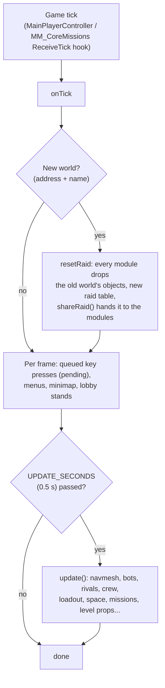

# PvEDirector: the mod that turns an offline raid into a PvE raid

`Scripts/main.lua` is the director: settings (`CFG`), the per-frame tick, the half-second update, hooks and keys. Every
system lives in its own module. Before changing a system, find its section in the research log: [NOTES.md](../../NOTES.md)
indexes every section by topic file (search it for the module's name).

## How a frame runs

- **Everything runs on the game thread**, from the tick hook. Key binds and the `LoopAsync` thread only queue work
  (`table.insert(pending, fn)`); calling game objects from them crashed or hung the game.
- **Per-raid state lives in `raid`**, rebuilt on every world change. Never keep an object from one world in the
  next: freed objects crash whatever touches them. Check kept objects with `valid(x)`, not `x:IsValid()`.
- **A module's shape:** `local M = {}`, `M.init(ctx)` to receive main's helpers (`log`, `valid`, `lib`...),
  `M.setRaid(r)` if it reads `raid` (and listed in `shareRaid`), `M.reset()` if it holds objects, `return M`.
- **Lua's 200-locals limit:** each file's top level must keep 20 spare. `python scripts/luacheck.py <file>` says how
  many. Don't dodge it with globals; move code into a module.

## Which module owns what

| Area | Modules |
|---|---|
| Director | `main.lua` (CFG, tick, update, hooks, keys), `outref.lua` (frees UE4SS's out-param refs), `pveproject.lua` (the project folder, written by mode.ps1, not committed) |
| Soldiers on stations | `bots.lua` (spawn, wake, arm, patrol, fight), `ai.lua` (difficulty and personalities, see AI_DESIGN.md), `cover.lua` (baked cover, `cover/`), `playareas.lua` (where bots may go), `botdamage.lua`, `hitzones.lua` (your shots at them, #123), `voice.lua`, `voicelines.lua`, `civilians.lua` (unarmed miners, prisoners and workers, #81) |
| Rival crews | `rivals.lua` (the brain and public API), `rivalcrews.lua` (who they are), `rivalships.lua` (ships, docking, turrets), `rivalbodies.lua` (people on foot), `rivalcombat.lua` (pods, ship fights, boarding), `shipnav.lua` (steering), `gearscale.lua` |
| Your crew | `hire.lua` (recruits), `crew.lua` (crew in raids), `crewlobby.lua` (crew in the hangar) |
| Into and out of a raid | `launch.lua` (matchmaking, map travel), `mappick.lua` (map choice), `loading.lua`, `splash.lua`, `lobbylabel.lua`, `loadout.lua` (gear in, loot out, extraction), `raidtime.lua`, `conditions.lua` (raid conditions for events, #78), `killstats.lua`, `quit.lua` |
| Space maps | `space.lua` (pods, docking, sublevels), `interiors.lua`, `gunseat.lua` (manning a turret), `levelprops.lua` (fans and hum, #143) |
| Missions and map | `missions.lua` (contracts count offline), `minimap.lua` |
| Your gear and stash | `gear.lua`, `itemdata.lua`, `female.lua`, `headfit.lua`, `invqol.lua` (sort, search), `invkeys.lua`, `keys.lua` (your key bindings), `guild.lua` (offline guild, #68) |
| Effects | `bulletholes.lua` (bullet holes in walls and floors, F3 Effects; see [BULLET_IMPACTS.md](../../docs/internals/BULLET_IMPACTS.md)) |
| Doors and tools | `blowtorch.lua` (the torch burns a vault door's three locks offline, with diagrams in [BLOWTORCH.md](BLOWTORCH.md)) |
| Testing | `tuning.lua` (F3 sliders), `debugmenu.lua`, `debugactions.lua`, `debuggive.lua` (F9) |

## Keys

F2 body female/male, F3 AI tuning, F9 debug menu, N / M / B minimap on-off / overview / next task, J / K stash
quick discard / quick move.

## Testing a change

The game copies `mods/` at launch, so relaunch after editing. Use a throwaway save. From Git Bash,
`scripts/send.sh "lua <code>"` runs code in the game (reply in `bridge/out.txt`); the mod's log ends up in
`backend/last_game.log`.
